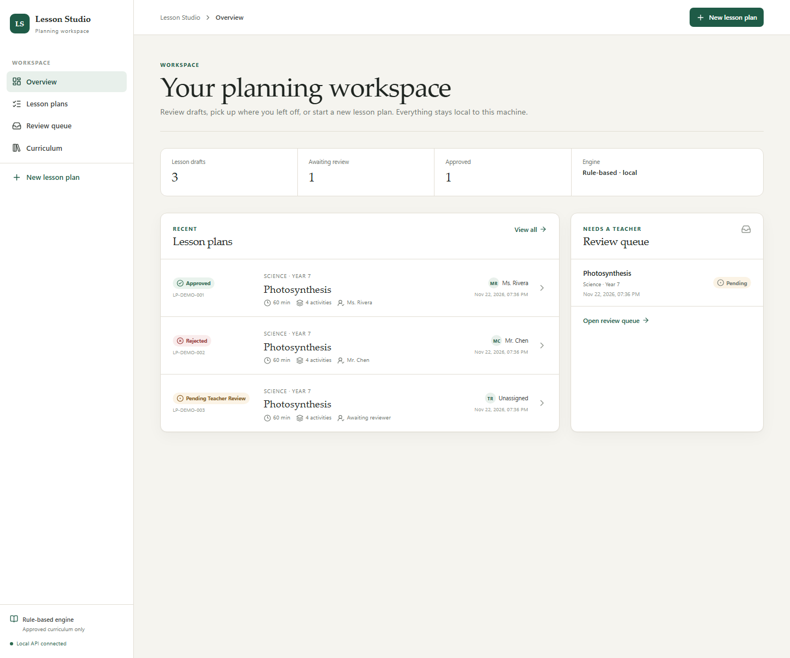
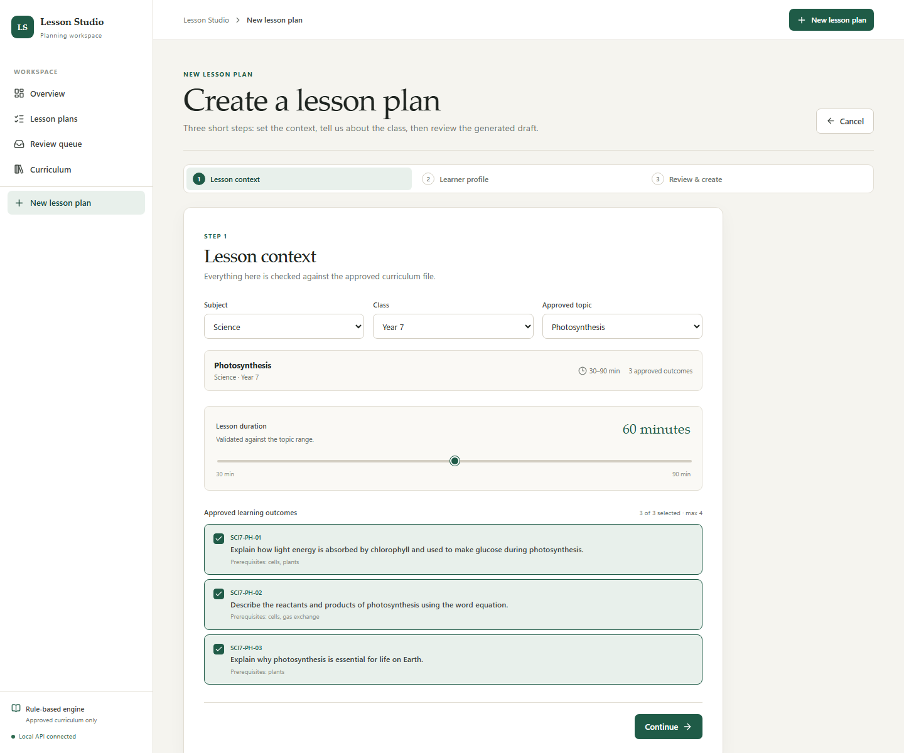
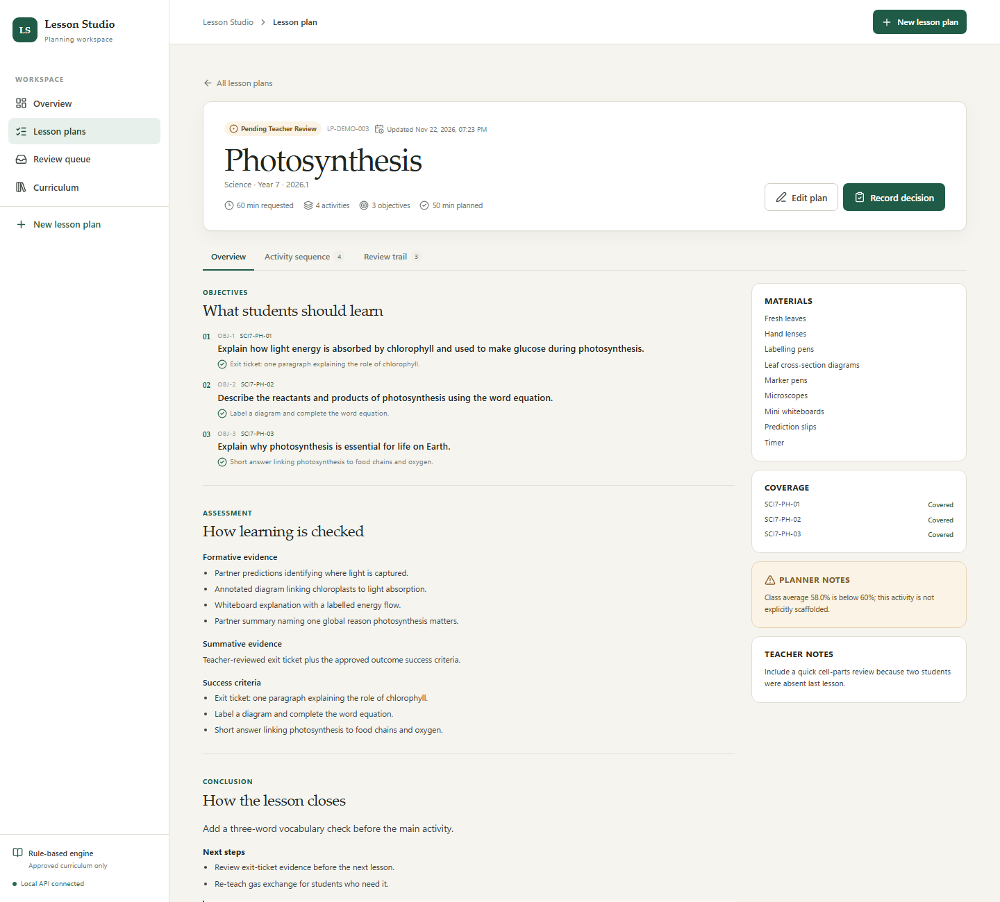
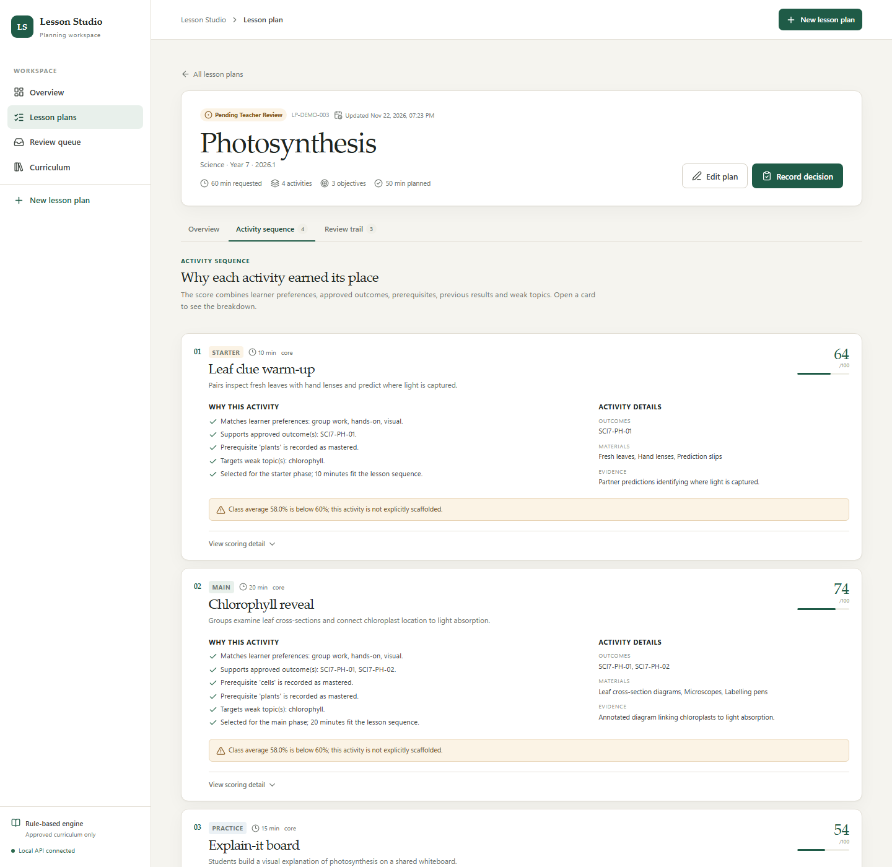
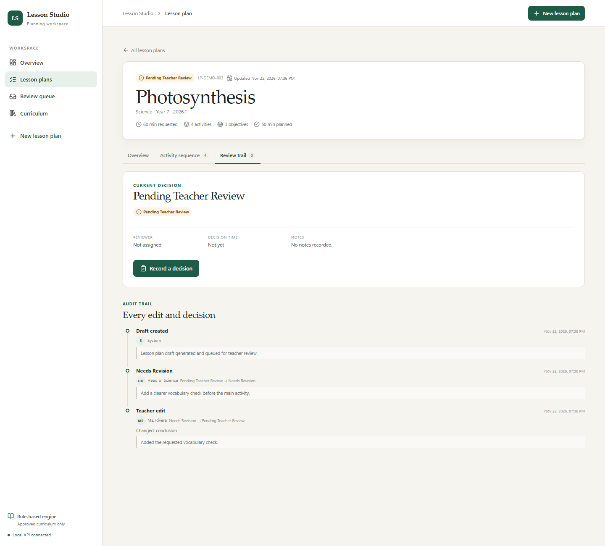
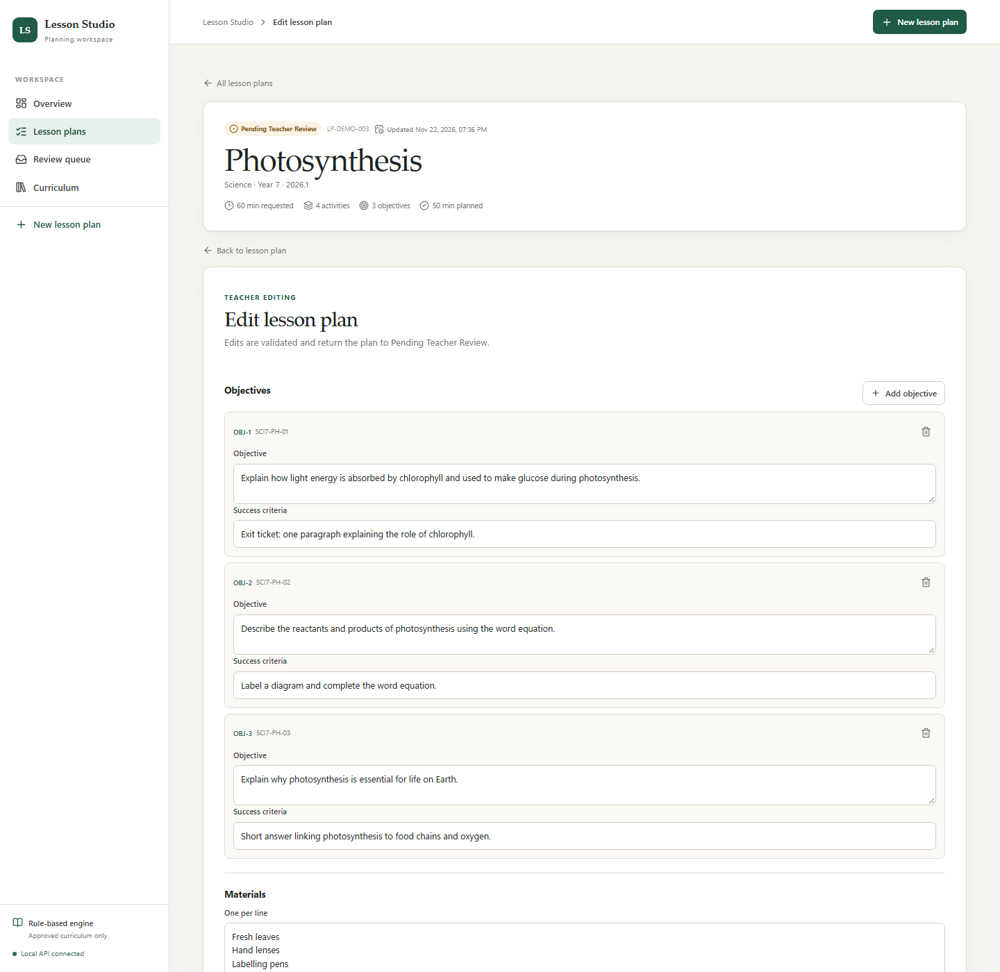
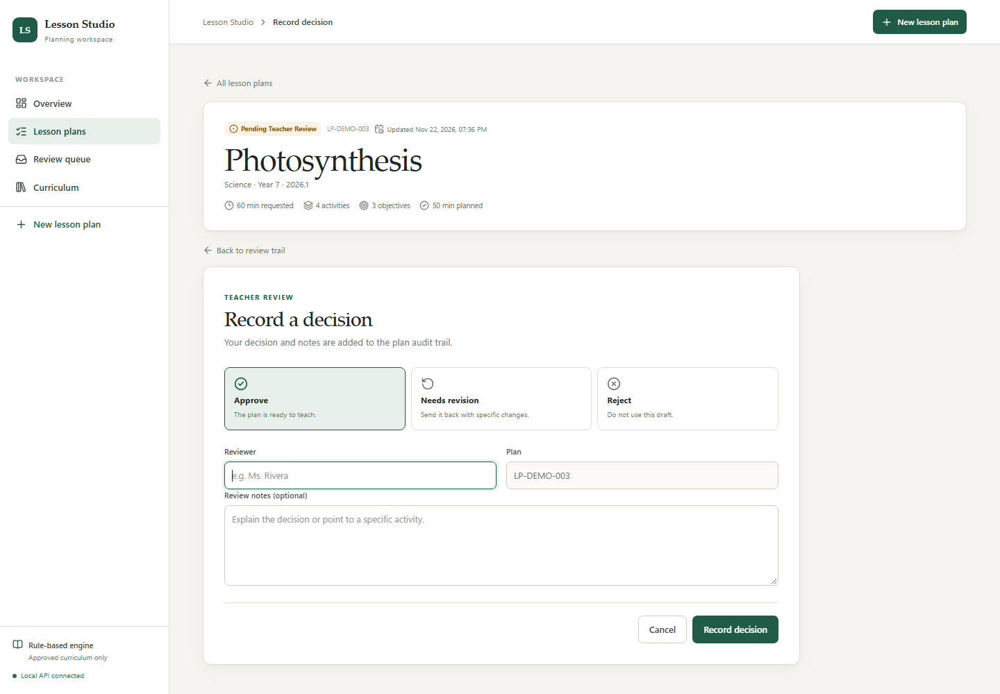

# FIP Beginner Capstone 02 - Lesson Plan Prompt Workflow

A rule-based Python engine with a polished **React + TypeScript** teacher studio.
It turns a lesson request into a structured **JSON lesson plan draft**, explains
every activity recommendation, and supports a full teacher review workflow of
**Pending Teacher Review**, **Approved**, **Rejected** and **Needs Revision**.

**Status:** complete prototype, tested, and documented. This is Project 2 of the
8 FIP Beginner capstone projects.

> **Sample data notice:** the curriculum, activities and teacher request in this
> project are synthetic examples written for the capstone. They are not real
> school policy, curriculum or assessment guidance.

---

## Preview











| Full-page teacher edit | Dedicated decision page |
|---|---|
|  |  |

---

## What it does

The project addresses the brief with a deterministic Python rules engine rather
than a paid language model. The frontend is a routed React 19 app built with
Vite and TypeScript. No API keys or paid services are used, and the running app
makes no calls outside the local machine.

| Requirement | Implementation |
|---|---|
| Lesson input template | `data/lesson_request_template.json` and `python app.py template` |
| Curriculum constraints | Approved subject, class, topic, duration and outcome IDs validated against `data/curriculum.json` |
| Activity ranking | Weighted score from learner preferences, approved outcomes, prerequisite tags, previous results and weak topics |
| Explain every activity | Every recommendation has `reasons`, `warnings` and a visible `score_breakdown` |
| Structured JSON draft | Objectives, materials, activities, assessment and conclusion |
| Teacher review workflow | Pending, Approved, Rejected and Needs Revision states |
| Teacher editing | Drafts can be edited before approval or after a revision request |
| Decision records | Full review history in the plan plus an append-only JSONL audit log |
| Safe errors | Validation and state errors return readable JSON; no tracebacks to users |
| Teacher UI | Multi-page React workspace: overview, plans, review queue, curriculum, wizard, plan detail, editing and decisions |

---

## Quick start

Requirements:

- **Python 3.13** for the rule engine, API and tests. `requirements.txt` contains
  no third-party Python packages.
- **Node.js 20+ and npm** for the React frontend. Dependencies are listed in
  `frontend/package.json`.

Open a terminal in the project folder (the folder containing `app.py`).

### Development: React dev server + Python API

```powershell
# Terminal 1 - Python API on port 8000
py -3.13 app.py serve

# Terminal 2 - React dev server on port 5173
cd frontend
npm install
npm run dev
```

Open **http://localhost:5173**. Vite proxies `/api` to the Python server.

### Production-style: build once, serve everything from Python

```powershell
cd frontend
npm install
npm run build
cd ..

py -3.13 app.py serve
```

Open **http://127.0.0.1:8000**. The Python server serves the built React app and
the JSON API from the same origin.

### CLI and tests

```powershell
# Validate the sample request
python app.py validate --input data/sample_request.json

# Generate and save a lesson plan draft
python app.py create --input data/sample_request.json

# Run the scripted CLI demonstration
python app.py demo

# Run the full automated test suite
python -m unittest discover -s tests -v
```

The virtual environment is optional, but it keeps the Python side isolated.

---

## Commands

| Command | Purpose |
|---|---|
| `python app.py template` | Print the lesson request template |
| `python app.py validate --input FILE` | Validate a request against the curriculum without generating a plan |
| `python app.py create --input FILE [--plan-id ID] [--out FILE]` | Generate and save a plan draft |
| `python app.py list` | List saved plans and their review status |
| `python app.py show PLAN_ID` | Show one saved plan as JSON |
| `python app.py edit PLAN_ID --file EDITS.json [--actor NAME]` | Edit a draft before approval |
| `python app.py review PLAN_ID --decision approved\|rejected\|needs_revision --reviewer NAME [--notes TEXT]` | Record a teacher decision |
| `python app.py demo` | Run the complete CLI demonstration |
| `python app.py serve [--port 8000]` | Start the JSON API and serve the built React UI |
| `python -m unittest discover -s tests -v` | Run all 140 automated tests |
| `cd frontend && npm run dev` | Start the React development server |
| `cd frontend && npm run build` | Type-check and build the React app into `frontend/dist` |

All commands run from the project folder. Use `--store PATH` before the command
to keep generated plans somewhere other than the default `var/` directory, for
example:

```powershell
python app.py --store var/demo demo
```

---

## Teacher studio (React UI)

The UI is a React 19 + TypeScript + Vite frontend in `frontend/` with separate
routed screens for each task. It talks to the Python API through a local JSON
contract:

| Screen | What it does |
|---|---|
| Overview | Workspace summary, recent drafts and the current review queue |
| Lesson plans | Full searchable plan library with status filters |
| Review queue | Dedicated queue of drafts waiting for a teacher decision |
| Curriculum | Browse approved subjects, classes, topics and outcomes |
| New lesson plan | Three routed steps: context, learner profile and review |
| Plan detail | Objectives, materials, assessment, conclusion and coverage |
| Activity reasoning | Reasons, warnings and a weighted score breakdown for every activity |
| Teacher edit page | Full-page editing for objectives, materials, activities, assessment and conclusion |
| Decision page | Full-page approval, rejection or revision request with reviewer notes |
| Review trail | Full timestamped history of creation, edits and decisions |

### JSON API

| Method | Path | Purpose |
|---|---|---|
| `GET` | `/api/health` | Service status and plan count |
| `GET` | `/api/meta` | Approved topics, outcomes, preferences and limits |
| `GET` | `/api/plans` | Plan summaries with status and review metadata |
| `POST` | `/api/plans` | Generate and save a plan draft |
| `GET` | `/api/plans/{id}` | Full plan details |
| `PATCH` | `/api/plans/{id}` | Apply validated teacher edits |
| `POST` | `/api/plans/{id}/review` | Record an approval, rejection or revision request |

The API is local-only, binds to `127.0.0.1` by default, and returns the same
typed error shape as the CLI. The React dev server proxies `/api` to port 8000;
the production build is served by Python at the same origin.

---

## Input template

The template is available in two forms:

- `data/lesson_request_template.json`
- `python app.py template`

| Field | Type | Rules |
|---|---|---|
| `subject` | string | Must exist in the approved curriculum |
| `class_name` | string | Must be approved for the subject |
| `topic` | string | Must be approved for the subject and class |
| `duration_minutes` | integer | Must fit both the global limit and the topic limit |
| `learner_preferences` | list of strings | 1-5 values from the allowed preference list |
| `previous_results` | object | Class average, completion rate, weak topics and mastered tags |
| `approved_outcome_ids` | list of strings | 1-4 approved outcome IDs for the topic |
| `teacher_notes` | string | Optional context for the plan |

Allowed learner preferences:

`visual`, `auditory`, `reading/writing`, `kinesthetic`, `hands-on`,
`group work`, `independent`, `discussion`, `digital`.

`previous_results` contains:

```json
{
  "class_average": 58,
  "completion_rate": 0.72,
  "weak_topics": ["chlorophyll", "gas exchange"],
  "mastered_tags": ["cells", "plants"]
}
```

- `class_average` must be between 0 and 100.
- `completion_rate` must be between 0 and 1.
- A tag cannot appear in both `weak_topics` and `mastered_tags`.
- Approved outcomes must belong to the requested topic. An outcome from another
  subject, class or topic is rejected with a helpful list of valid IDs.

---

## Sample data

`data/curriculum.json` contains four approved topics and nine outcomes:

| Subject | Class | Topic | Outcomes |
|---|---|---|---|
| Science | Year 7 | Photosynthesis | 3 |
| Science | Year 7 | Forces and Motion | 2 |
| English | Year 8 | Persuasive Writing | 2 |
| Mathematics | Year 7 | Fractions | 2 |

`data/activities.json` contains **29 sample activities** across those topics.
Each activity has:

- a phase: `starter`, `main`, `practice` or `plenary`
- a duration in minutes
- learner-preference tags
- prerequisite tags and target tags
- supported approved outcome IDs
- materials and assessment evidence

The demo uses `data/sample_request.json` (Science / Year 7 / Photosynthesis)
and `data/sample_edits.json` (a teacher revision of the objectives, assessment
and conclusion).

---

## How it works

### 1. Validate the request

`src/validation.py` checks types, required fields, ranges, duplicates and
unknown fields. It then asks the curriculum layer to verify the subject, class,
topic, duration and approved outcome IDs.

### 2. Look up the approved curriculum

`src/curriculum.py` loads the approved topics and outcomes. It rejects requests
for unknown topics, durations outside the topic range, and outcome IDs that are
not approved for that exact topic.

### 3. Rank the activities

`src/ranking.py` scores every activity that matches the subject and topic. The
weights are configured in `config.json`:

```text
score =
  0.30 * preference_match +
  0.30 * outcome_alignment +
  0.15 * prerequisite_readiness +
  0.15 * previous_results_fit +
  0.10 * weak_topic_alignment
```

| Factor | Rule |
|---|---|
| Preference match | Share of the teacher's learner preferences present in the activity tags |
| Outcome alignment | Share of selected approved outcomes supported by the activity |
| Prerequisite readiness | Mastered prerequisites add credit; weak prerequisites reduce the score and add a warning |
| Previous results fit | Low class averages favour scaffolded/review activities; high averages favour challenge/extension activities; low completion rates favour interactive activities |
| Weak-topic alignment | Share of the class's weak topics targeted by the activity |

Every factor is written to `score_breakdown` as a raw value, weight and points.
Every activity also carries human-readable `reasons` and `warnings`, so the
teacher can see **why** it was recommended, not just its rank.

### 4. Build a phase-balanced plan

`src/planner.py` selects the best starter, main and plenary activities, trying
to include a practice activity as well. It reserves time for later phases,
avoids duplicates, and adds extra main/practice activities when time remains.
The plan reports `planned_minutes` and any remaining `flex_minutes`.

Short essential sections are not paraphrased: objectives come directly from the
approved outcomes, and assessment success criteria come from the same outcomes.

### 5. Produce the structured JSON draft

The generated plan contains:

```json
{
  "plan_id": "LP-...",
  "status": "Pending Teacher Review",
  "request": {},
  "curriculum": {},
  "objectives": [],
  "materials": [],
  "activities": [],
  "assessment": {},
  "conclusion": {},
  "timing": {},
  "warnings": [],
  "coverage": {},
  "review": {
    "status": "Pending Teacher Review",
    "reviewer": null,
    "decided_at": null,
    "notes": null,
    "history": []
  }
}
```

Each activity includes its title, phase, duration, materials, supported
outcomes, `score`, `score_breakdown`, `reasons` and `warnings`.

---

## Teacher review workflow

```text
Created
   |
   v
Pending Teacher Review
   |          |             |
   |          |             +--> Needs Revision --(teacher edit)--> Pending Teacher Review
   |          |
   |          +--> Rejected
   |
   +--> Approved
```

| Status | Meaning |
|---|---|
| Pending Teacher Review | Draft is generated and waiting for a teacher decision |
| Approved | Teacher accepted the plan; no further edits or decisions are allowed |
| Rejected | Teacher rejected the plan with required notes; no further edits or decisions are allowed |
| Needs Revision | Teacher requested changes with required notes; the teacher can edit and resubmit |

### Teacher editing

`python app.py edit` accepts a JSON file containing any of:

- `objectives`
- `materials`
- `activities`
- `assessment`
- `conclusion`
- `note`

Edits are validated. Activities must use a valid phase and must not exceed the
requested lesson duration. An edit resets the plan to **Pending Teacher Review**
and records the changed fields, actor, timestamp and note in the review history.
Approved and rejected plans cannot be edited.

### Review records

Every plan keeps a `review.history` list. Each entry contains:

- `timestamp_utc`
- `action` (`created`, `edited` or `decision`)
- `actor`
- `from_status` and `to_status`
- `details` such as changed fields or review notes

Decisions are also appended to `var/review_history.jsonl` as an audit log.
`var/` is excluded from Git.

---

## Demo

```powershell
python app.py demo
```

The demo runs these scenarios:

1. Successful generation of a plan with explained activity recommendations.
2. Invalid duration and an unapproved outcome, both handled with safe JSON errors.
3. Teacher editing before approval.
4. Approval with reviewer name and notes.
5. Rejection with required reviewer notes.
6. A Needs Revision decision followed by an edit and resubmission.

The captured output is in `outputs/demo_transcript.md`. A generated sample plan
is in `outputs/sample_lesson_plan.json`.

---

## Testing

```powershell
python -m unittest discover -s tests -v
```

Result: **140 tests passed, 0 failed**.

The tests cover:

- input validation and safe error serialisation
- curriculum lookup, duration and outcome constraints
- activity data loading and malformed-data handling
- preference, outcome, prerequisite, previous-results and weak-topic ranking
- score breakdowns and activity explanations
- plan generation, phase ordering, timing and coverage
- every review status and state transition
- teacher editing, validation and review history
- JSON storage, path safety and the append-only audit log
- CLI commands, safe failures and the complete demo
- local JSON API routes, CORS preflight, static hosting and API error responses

The Python suite is fully offline and uses only `unittest` and temporary
directories. The React app is type-checked and bundled with:

```powershell
cd frontend
npm run build
```

---

## Project structure

```text
02-Lesson-Plan-Prompt-Workflow\
|-- app.py                         # CLI / API entry point
|-- config.json                    # limits, preferences, weights, thresholds
|-- requirements.txt               # no third-party Python packages
|-- README.md
|-- data\
|   |-- curriculum.json            # approved subjects, classes, topics and outcomes
|   |-- activities.json            # 29 sample activities
|   |-- lesson_request_template.json
|   |-- sample_request.json
|   `-- sample_edits.json
|-- src\
|   |-- validation.py              # request validation
|   |-- curriculum.py              # curriculum constraints
|   |-- activities.py              # activity data model and loading
|   |-- ranking.py                 # transparent weighted ranking
|   |-- planner.py                 # phase-balanced plan generation
|   |-- review.py                  # editing and review state machine
|   |-- storage.py                 # safe JSON storage and review log
|   |-- service.py                 # application workflow
|   |-- server.py                  # local JSON API + static React host
|   |-- demo.py                    # scripted demonstration
|   |-- cli.py                     # command-line interface and serve command
|   |-- config.py
|   |-- errors.py
|   `-- __init__.py
|-- frontend\
|   |-- package.json
|   |-- package-lock.json
|   |-- vite.config.ts
|   |-- tsconfig*.json
|   |-- index.html
|   |-- public\                    # favicon and static assets
|   `-- src\
|       |-- main.tsx
|       |-- App.tsx
|       |-- api.ts
|       |-- types.ts
|       |-- utils.ts
|       |-- index.css
|       |-- components\            # shell, page header, plan rows, activity cards
|       `-- pages\                 # overview, plans, review queue, curriculum, wizard, plan pages
|-- tests\                         # 8 test modules plus helpers
|-- outputs\
|   |-- demo_transcript.md
|   `-- sample_lesson_plan.json
`-- var\                           # runtime plans and review log, ignored by Git
```

---

## Design decisions

1. **Rule-based, not model-based.** The brief allows a rule-based approach. It
   is deterministic, free, inspectable and works without a network connection.
2. **Approved outcomes are the source of truth.** Objectives are derived from
   curriculum outcome IDs. The application never invents a learning outcome.
3. **Explain every recommendation.** A score alone is not enough for a teacher.
   Each activity exposes its score breakdown, positive reasons and warnings.
4. **Two layers of review history.** The plan keeps its full in-file history, and
   decisions are also appended to a JSONL audit log for easy inspection.
5. **Strict but helpful validation.** Errors name the field and, where useful,
   list valid subjects, classes, topics, preferences or outcome IDs.
6. **Safe persistence.** Plan IDs are restricted to a safe pattern, writes use a
   temporary file and atomic replace, and path traversal is rejected.
7. **Standard-library Python backend.** `argparse`, `json`, `unittest`,
   `dataclasses`, `pathlib` and `http.server` keep the engine and API setup
   simple and reproducible.
8. **React for the teacher experience.** The frontend uses React 19, TypeScript,
   Vite and Lucide icons. It keeps the rich interaction layer separate from the
   deterministic engine and exposes every rule through the API.
9. **No external UI assets at runtime.** Fonts use the local system stack and the
   build contains no remote images or CDN dependencies, so the built app works
   offline once dependencies are installed.
10. **Synthetic data.** The sample curriculum and activities are fictional and
    safe to share. They demonstrate the rules without implying real curriculum
    authority.

---

## Error handling

Application errors are typed in `src/errors.py`. The CLI catches expected errors
and prints JSON such as:

```json
{
  "error": {
    "type": "validation_error",
    "message": "duration_minutes must be between 20 and 180.",
    "field": "duration_minutes"
  }
}
```

The command exits with code `2` and never prints a traceback for expected input
or state errors. Unexpected file errors are also reported as JSON.

---

## Limitations

- The curriculum and activities are small synthetic samples, not a real school
  curriculum.
- Matching is keyword/tag-based. It does not understand nuanced phrasing or
  infer an unstated preference.
- The previous-results rules are hand-tuned thresholds, not a learned model.
- Activity durations are estimates and may need teacher adjustment.
- Selection aims for a balanced starter/main/practice/plenary sequence but can
  leave flexible minutes when no remaining activity fits.
- Plans are stored locally as JSON files. There is no database, multi-user
  locking or authentication. The API and UI are intended for a single local user.
- The React UI requires a Node.js toolchain for development or a one-time
  production build. The built assets are served by the Python server.
- Browser behaviour is represented by the typed API contract and production
  build checks; there is no automated end-to-end browser test suite.
- Teacher names and review notes are stored in `var/`; that directory is ignored
  by Git and should be reviewed before sharing.
- The application does not replace professional judgement, safeguarding advice
  or school approval processes.

---

## Security and privacy

- No API keys, passwords, tokens or paid services are used.
- The running app makes no calls outside the local machine. `npm install` is only
  needed during setup or a fresh build.
- The API binds to `127.0.0.1` by default and serves the same-origin built UI.
- `.gitignore` excludes `.venv/`, `.env*`, `node_modules/`, `dist/`, caches, logs
  and the `var/` runtime directory.
- Plan IDs are validated before being used in file paths.
- Request bodies are size-limited; user-provided text is length-limited and
  validated before storage.
- All sample content is synthetic.
